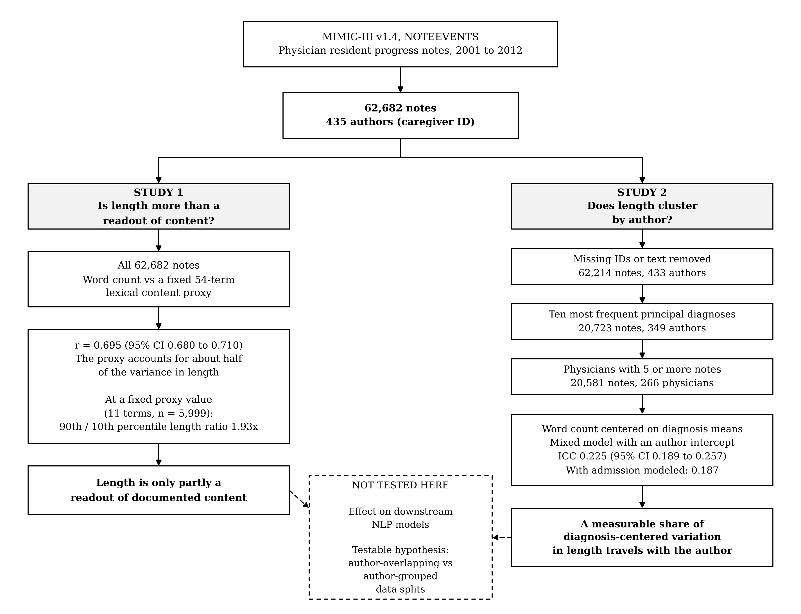

# physician-signature

Code for the manuscript:

**An Author-Level Component of Clinical Note Length: Evidence from MIMIC-III Resident Progress Notes and a Testable Hypothesis for Clinical Natural Language Processing**

Tejus B R. Manuscript in submission. The preprint link and citation details will be added here when available.



This repository contains analysis code only. It contains no data, no clinical text, and no notebook outputs. Running it requires credentialed access to MIMIC-III (see [DATA_ACCESS.md](DATA_ACCESS.md)).

---

## The question

Clinical natural language processing usually treats a note as a container for clinical content and discards who wrote it. This study asks a narrow first question: how much of the variation in one structural property of the note, its length, travels with the individual author once the diagnosis is accounted for?

The work has two parts.

| | Question | Corpus |
|---|---|---|
| **Study 1** | Is note length more than a readout of documented content? | 62,682 resident progress notes, 435 authors |
| **Study 2** | Does variation in note length cluster by author within principal diagnosis? | 20,581 notes, 266 physicians, 10 diagnoses |

Study 1 establishes a precondition: if length were purely a readout of content, there would be no room for any non-content source of variation. Study 2 asks whether variation in length is organized by author. Study 2 does not use the content proxy from Study 1; it removes differences between principal diagnoses only.

## Main results

| Quantity | Value |
|---|---|
| Correlation, word count vs distinct content-proxy terms (Study 1) | r = 0.695 (95% CI 0.680 to 0.710) |
| Variance in length accounted for by the content proxy | about half (r squared = 0.484) |
| Length ratio, 90th to 10th percentile, at a fixed proxy value of 11 concepts (n = 5,999) | 1.93x |
| Author share of diagnosis-centered variance, single author intercept (Study 2, primary) | ICC = 0.225 (95% CI 0.189 to 0.257) |
| Author share with admission modeled within author | 0.187 (admission share 0.244) |
| One random note per author-admission, 20 draws | mean 0.201 (middle 90% of draws 0.184 to 0.213) |
| Difference in mean centered length, 10th vs 90th percentile physicians | 334 words per note |

The full list of reproducible values, with the exact digits printed by the notebooks, is in [results/expected_numbers.md](results/expected_numbers.md).

### What these results do and do not show

They show that, in this corpus, resident note length clusters measurably by author after accounting for principal diagnosis. They do **not** show that this author component changes the output of any downstream model. Whether it does is a testable hypothesis, set out in the Discussion of the manuscript, and no downstream model was trained or evaluated here.

Because Study 2 does not condition on the content proxy, the author component may reflect how much each author documents as well as how it is written. Care unit, clinical service, calendar period, and within-diagnosis case mix were not modeled and cannot be excluded. See the Limitations section of the manuscript.

---

## Repository structure

```
physician-signature/
  README.md                     this file
  docs/
    graphical_abstract.png      one-page summary of the design and findings
  DATA_ACCESS.md                how to obtain credentialed MIMIC-III access
  LICENSE                       MIT, covering the code only
  CITATION.cff                  citation metadata
  requirements.txt              Python package versions used
  notebooks/
    study1_length_vs_content.ipynb    Study 1
    study2_author_variance.ipynb      Study 2
  results/
    expected_numbers.md         values a correct run should reproduce
  scripts/
    check_before_push.py        safety check run before every commit
```

## Requirements

1. Credentialed PhysioNet access to MIMIC-III Clinical Database v1.4, with access to the `physionet-data` datasets on Google BigQuery. See [DATA_ACCESS.md](DATA_ACCESS.md).
2. A Google Cloud project of your own, used to run BigQuery queries.
3. Python 3.13 with the packages in `requirements.txt`. The analyses were run in Google Colab.

Versions used for the reported results: Python 3.13.15 (Linux), pandas 2.2.3, NumPy 2.1.3, statsmodels 0.15.0, matplotlib 3.10.0.

## How to reproduce

1. Open a notebook in Google Colab (File, Upload notebook) or in a local Jupyter environment.
2. Replace `YOUR-GCP-PROJECT-ID` with the ID of your own Google Cloud project. In Study 1 it is set in the second code cell (`MY_PROJECT_ID`); in Study 2, in the first code cell (`PROJECT_ID`).
3. Run **Study 1** from top to bottom. Then run **Study 2** from top to bottom. Each notebook loads its own data and does not depend on the other.
4. Compare the printed blocks headed `STUDY 1 NUMBERS FOR MANUSCRIPT` and the Study 2 `PAPER NUMBERS` block (and the later verification cells) with [results/expected_numbers.md](results/expected_numbers.md).

Several cells check themselves before running. They stop with a message beginning `STOP:` unless the cohort has the expected number of notes and authors and the correlation reproduces to within 0.0003. A `STOP` almost always means the notebook was not run from the top in a fresh session.

Approximate runtimes in Colab: Study 1 a few minutes, most of it the BigQuery pull. Study 2 about 30 minutes, of which the 1,000-replicate bootstrap for the ICC takes about 25.

### Reproducibility of seeded results

BigQuery does not guarantee row order, and the queries do not contain `ORDER BY`. Statistics that do not depend on row order (counts, means, the correlation, the ICC and the mixed-model variance components) reproduce exactly.

- **Study 2** sorts rows by `ROW_ID`, the unique note identifier in `NOTEEVENTS`, immediately after retrieval and before any seeded step, so a given seed selects the same notes on every run.
- **Study 1** is not sorted before its bootstrap. That bootstrap draws authors by position, and the author order follows row order, so the reported interval for r is one valid realization. A new run may differ in the third decimal place. The correlation itself is unaffected.

Seeds: random note selection uses seeds 0 to 19; both bootstraps use seed 2026.

---

## Method summary

**Corpus.** All notes in `physionet-data.mimiciii_notes.noteevents` with `CATEGORY = 'Physician'` and `DESCRIPTION = 'Physician Resident Progress Note'`. Notes flagged in `ISERROR` (113, 0.18%) are retained. No minimum length is imposed. The caregiver identifier `CGID` is treated as the note's author.

**Word count.** Letter-only tokens matched by the regular expression `[a-zA-Z]+` on lowercased text. Numeric tokens such as laboratory values, doses, dates and times are excluded, so the measure reflects composed prose rather than total information volume.

**Content proxy.** The number of distinct terms, from a fixed list of 54 single-word clinical terms, that appear at least once in the note. The list is short enough to inspect in full for any term that tracks length:

| Group | Terms |
|---|---|
| Symptoms | pain, fever, cough, nausea, vomiting, dyspnea, fatigue, edema, dizziness, headache, weakness, bleeding, rash |
| Findings | hypertension, hypotension, tachycardia, bradycardia, afebrile, hypoxia, murmur, rales, wheezing, tenderness |
| Conditions | sepsis, pneumonia, failure, infarction, diabetes, copd, stroke, embolism, arrhythmia, anemia, infection |
| Medications and treatment | antibiotics, insulin, heparin, warfarin, furosemide, morphine, aspirin, steroids, diuretic, anticoagulation |
| Clinical actions | admitted, discharged, intubated, transfused, prescribed, started, discontinued, titrated, monitored, consulted |

Both measures are counted over the same token stream, so part of their association may reflect the instrument rather than the notes. The proxy has no negation handling and no multi-word concepts, and it has not been validated against an independent content measure.

**Study 2 model.** Principal diagnosis is `SEQ_NUM = 1` in `physionet-data.mimiciii_clinical.diagnoses_icd`, linked by `HADM_ID`. The cohort is restricted to the ten most frequent principal diagnoses by note count and to physicians with at least five notes across them. Each note's word count is centered on the mean for its diagnosis. A linear mixed-effects model with a random intercept for author is fitted by restricted maximum likelihood in statsmodels:

```python
smf.mixedlm("centered ~ 1", data=work, groups=work["CGID"]).fit(reml=True)
```

ICC = author variance / (author variance + residual variance). A second model adds a variance component for admission nested within author. The 95% confidence interval for the ICC comes from resampling physicians with replacement (1,000 replicates).

**Robustness analyses** (none prespecified): one note per author-admission (earliest by `ROW_ID`, and random over 20 draws); separate fits within each diagnosis; a moment decomposition; log-transformed word count; minimum-length thresholds of 10 and 50 words; matched within- and between-physician dispersion.

## A note on the notebooks' printed commentary

The notebooks are the working record of the analysis and are kept as run, apart from cleared outputs and a placeholdered project ID. Some print statements and comments carry working interpretations from earlier in the project. Where they differ from the manuscript, **the manuscript's wording governs**. In particular:

- Lines describing the earliest note in each admission as "the admission-day note" or as "not a selection artefact". The manuscript reports it as each author's earliest note within each admission and treats the copy-forward explanation as a hypothesis.
- A line describing 0.225 as "the CONSERVATIVE estimate". The admission model (0.187) shows the pooled value is inflated by repeated notes within admissions, not conservative.
- Comments calling low information density "padding" and describing the residual as "where author style lives". Information density is descriptive only and is not used in any inferential claim.

## Data use and privacy

- MIMIC-III is distributed by PhysioNet under a credentialed data use agreement. This repository does not contain or redistribute any MIMIC-III data.
- No raw note text is printed, stored, or written to disk by these notebooks. Where repeated lines had to be compared, they were compared as truncated SHA-256 hashes.
- Notebooks are committed with all outputs cleared, because outputs can contain row-level values from the database.
- Before every commit, run:

```bash
python scripts/check_before_push.py
```

It fails if a notebook still has outputs, contains a cloud project ID, uses a superseded cohort definition, or if any data file is present in the repository. It warns about code that could print note text.

## Citation

If you use this code, please cite the manuscript. Citation metadata is in [CITATION.cff](CITATION.cff) and will be updated with publication details.

## License

The code is released under the MIT License (see [LICENSE](LICENSE)). The license covers the code only. MIMIC-III data remain subject to the PhysioNet credentialed data use agreement.

## Author

Tejus B R, Bengaluru, India. ORCID [0009-0001-0965-1286](https://orcid.org/0009-0001-0965-1286). Contact: tejus.br2000@gmail.com

AI tools assisted with code; the author verified all output and is responsible for all analytical decisions.
